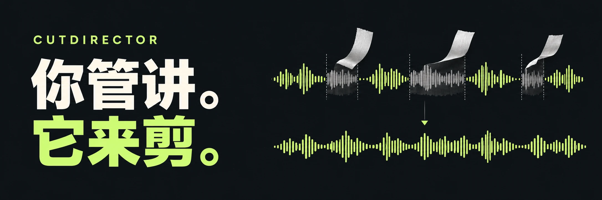
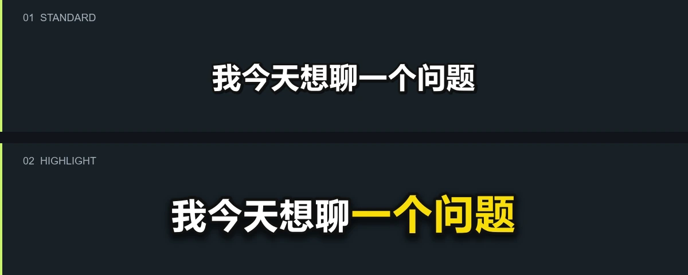

# CutDirector



<div align="center">

**剪停顿 · 删重说 · 配字幕**

给 Codex、Claude Code 的口播剪辑 Skill。交一条原片，拿到新视频 + SRT。

**[让它剪第一条 →](#start)**

</div>

<a id="怎么剪"></a>

## 你管讲，它来剪。

**你管讲**

> 嗯……我我我今天想聊一个问题。

**它来剪**

> 我今天想聊一个问题。

*剪辑规则示意。保留原话和自然表达，原片不覆盖。*

<a id="字幕样式"></a>

## 字幕，也配好了。



默认普通字幕。想突出重点，就说：**“字幕重点高亮。”** [六种样式 →](references/subtitle-gallery.md)

<a id="start"></a>
<a id="安装"></a>
<a id="使用"></a>

## 让它剪第一条

在 **Codex 对话**中安装：

```text
$skill-installer install https://github.com/Fangx-AI/cut-director
```

重启 Codex，把 `<视频路径>` 换成你的文件路径：

```text
使用 $cut-director 剪干净这条口播并配字幕：<视频路径>
```

[Claude Code / 手动安装 →](references/getting-started.md#安装)

需要环境已有的媒体处理与识别能力；没有逐字转写时，只处理停顿，不生成字幕。

---

**下次录口播，记住：你管讲，它来剪。**

[使用指南](references/getting-started.md) · [致谢](references/about.md) · [许可](LICENSE)
