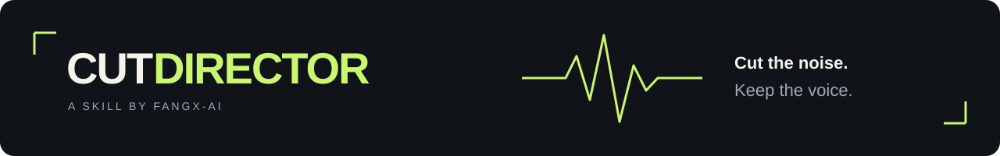

<div align="center">



# CutDirector

**拍完的口播，交给 AI 剪干净。**

去掉卡顿与重说，留住自然表达，再配上字幕。

[开始使用](#安装) · [看看怎么剪](#怎么剪) · [挑选字幕样式](#字幕样式)

</div>

CutDirector 是给 **Codex、Claude Code 等智能体**使用的口播剪辑 Skill。适合已经拍好、需要清理停顿和重录的知识分享、产品讲解与日常口播。

你给视频和一句要求；智能体按照剪辑规则处理，交付新视频、SRT 字幕和剪辑记录。默认保留自然节奏，原片始终保留。

## 怎么剪

**剪掉录制时的磕绊，保留表达时的语气。** 下面是规则示意，展示不同情况如何处理，并非实测样片：

| 原始口播 | 按规则处理后 |
| :--- | :--- |
| “我我我今天想聊一个问题” | “我今天想聊一个问题” |
| “三月……不对，四月上线” | “四月上线” |
| “这个功能可以……重来。这个功能可以帮你整理笔记。” | “这个功能可以帮你整理笔记。” |
| “非常非常关键” | **保留**，这是强调 |

- **重说几遍，挑更顺的一遍。** 依次比较内容完整性、流畅度、前后衔接和镜头状态，不机械保留最后一次。
- **停顿缩短，呼吸感留下。** 默认采用自然节奏；笑声、排比、刻意对比和包袱前的停顿按规则保留。
- **拿不准的地方，留给你判断。** 不确定就保留；交付时指出值得复听的位置，方便你要求局部重剪。

具体判断方法见 [剪辑规则](references/cut.md)。

## 安装

先准备一个支持 Skill 的智能体。CutDirector 提供剪辑规则，实际处理依赖当前环境已有的媒体处理和语音识别能力。

**在 Codex 对话中发送：**

```text
$skill-installer install https://github.com/Fangx-AI/cut-director
```

安装完成后重启 Codex，再发出下面的剪辑指令。

<details>
<summary>Claude Code 或手动安装</summary>

下载完整仓库，把包含 `SKILL.md`、`references/` 和 `scripts/` 的整个目录放到对应位置，再重启智能体：

| 智能体 | 安装目录 |
| :--- | :--- |
| Codex | `~/.codex/skills/cut-director` |
| Claude Code | `~/.claude/skills/cut-director` |

`~` 表示你的用户主目录。确认 `SKILL.md` 直接位于 `cut-director` 目录下，没有多套一层文件夹。

</details>

## 使用

把 `<视频路径>` 换成智能体能够读取的视频路径。在 Codex 中发送：

```text
使用 $cut-director 把这条口播剪干净并配上字幕：<视频路径>
```

在 Claude Code 中，把开头的 `使用 $cut-director` 换成 `/cut-director`，后面的要求和路径保持不变。

**剪完你会拿到：**

- **新的视频文件**：完成粗剪，字幕烧进画面，原片不覆盖。
- **一份 SRT**：方便继续校对或导入其他编辑器。
- **剪辑与字幕改动记录**：保存在成片旁边，供复核和后续修改。

智能体会说明剪前、剪后时长，并最多指出三处值得复听的位置。想调整某一处，直接用**成片时间**告诉它：

```text
成片 1:05 那句话换成前一遍，其他地方保持不变。
```

> [!NOTE]
> 完整的语义剪辑和字幕需要逐字时间的转写。拿不到时，按 Skill 规则只处理停顿，不制作字幕，并说明语气词、口误和重录尚未处理。

## 字幕样式

**默认清晰克制，需要时再突出重点。** 六种样式都以校对后的字幕为基础，只改样式，不改字、不加话。

### 普通字幕 · 默认

白字、深色描边与淡阴影，适合先把内容讲清楚。


### 重点高亮 · 按需开启

想让关键数字、术语或结论更醒目，可以这样说：

```text
字幕用重点高亮样式，每屏最多强调一个关键词。
```


以上是仓库内的静态样式示意；图中文字仅为字幕示例，不代表识别准确率。

还有 **半透明底条、综艺大字、极简、逐字变色**。逐字变色需要真实逐字时间；动态效果请以实际输出为准。

**[查看全部六种样式与适用场景 →](references/subtitle-gallery.md)**

## 按你的方式剪

在首次指令中加上一句偏好即可：

| 你想要 | 可以这样说 |
| :--- | :--- |
| 更快或更舒缓的节奏 | “节奏紧凑一点” / “节奏舒缓一点” |
| 只做粗剪 | “先剪干净，不要字幕” |
| 字幕另行导入编辑器 | “字幕只给 SRT，不要烧进画面” |
| 先审阅再出片 | “先给我看删除清单，确认后再剪” |

当前范围是口播粗剪与字幕。配乐、B-roll、调色和额外视觉特效不在这套 Skill 的流程内。

## 规则是公开的

想知道某句话为什么被删，或把规则调整成自己的习惯，可以从这里开始：

- [Skill 入口](SKILL.md)：完整流程、硬规则与交付约定。
- [剪辑规则](references/cut.md)：删什么、留哪一遍、在哪里下刀、如何自检。
- [字幕规则](references/subtitles.md)：文字校对、断句、时间同步与安全位置。
- [字幕样式参数](references/subtitle-styles.md)：六种样式、高亮词与逐字时间的用法。

遇到问题，欢迎 [提交 Issue](https://github.com/Fangx-AI/cut-director/issues)，附上使用的智能体、问题时间点和预期结果。

## 致谢

剪辑和字幕规则参考了 [video-use](https://github.com/browser-use/video-use)、[橙风剪口播](https://github.com/Agentchengfeng/chengfeng-videocut-skills)、[cut-video](https://github.com/louisedesadeleer/cut-video)、[FunClip](https://github.com/modelscope/FunClip)、[JJKoubo](https://github.com/darrenli6/JJKoubo) 的做法，并用真实口播实测修订。

## 许可

文档采用 [CC BY-SA 4.0](LICENSES/CC-BY-SA-4.0.txt)，脚本采用 [AGPL-3.0-or-later](LICENSES/AGPL-3.0-or-later.txt)。转载或改编文档请署名 **CutDirector by Fangx-AI**，并注明修改；品牌素材与各类文件的适用范围见 [LICENSE](LICENSE)。

**你自己的视频和成片仍归你，可以用于商业用途。**
