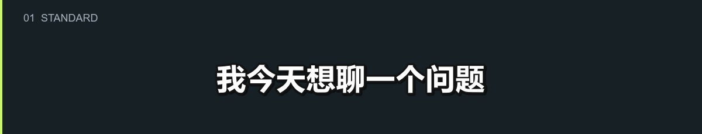
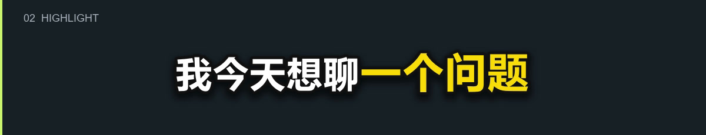
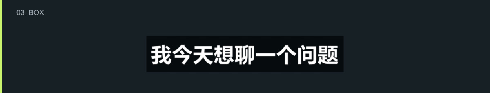
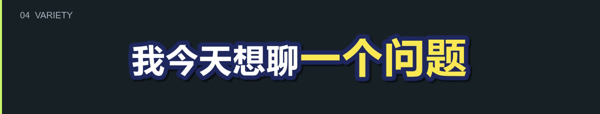
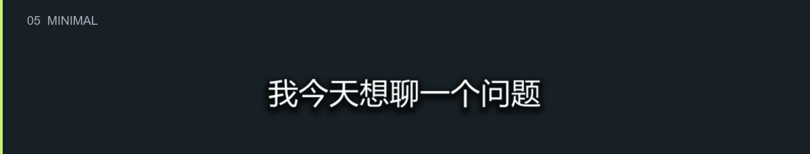
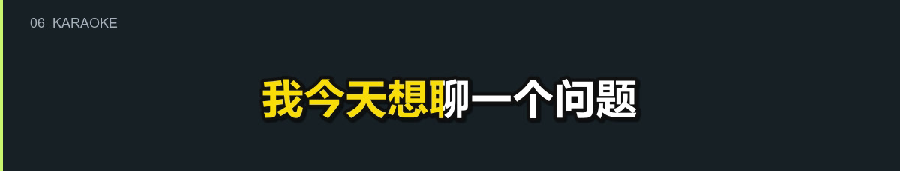

# 给这条口播选一款字幕

[← 返回首页](../README.md#字幕样式) · [查看样式参数与脚本用法](subtitle-styles.md)

CutDirector 默认使用普通字幕。需要美化时，告诉智能体样式名称即可；一条视频使用一种样式，保持位置和字号一致。

下面是用项目字幕脚本渲染的**静态样式预览**，统一使用“我今天想聊一个问题”。示例文字与时间用于排版展示；静帧不展示淡入、弹动或逐字变色过程。

| 你的画面或需求 | 从这款开始 |
| :--- | :--- |
| 日常口播，先保证清晰 | [普通 `standard`](#standard) |
| 突出术语、数字或结论 | [重点高亮 `highlight`](#highlight) |
| 背景复杂，文字容易被淹没 | [半透明底条 `box`](#box) |
| 偏娱乐、节奏快 | [综艺大字 `variety`](#variety) |
| 背景干净，希望更轻一些 | [极简 `minimal`](#minimal) |
| 文字跟随声音逐字变色 | [逐字变色 `karaoke`](#karaoke) |

<a id="standard"></a>

## 01 · 普通字幕

**`standard` · 默认样式**

白字、深色描边、淡阴影，适合大多数口播。没有指定样式时，就从这里开始。



<a id="highlight"></a>

## 02 · 重点高亮

**`highlight` · 美化与重点强调的首选**

粗白字配柔和阴影，每屏最多一个关键词变黄、适度放大。适合产品名、技术术语、确切数字和结论词。



```text
字幕用 highlight 样式，突出关键词，相邻两屏不要都高亮。
```

<a id="box"></a>

## 03 · 半透明底条

**`box` · 复杂背景下保持清晰**

用半透明黑色底条隔开字幕与背景。画面颜色多、单靠描边不够清楚时使用。



<a id="variety"></a>

## 04 · 综艺大字

**`variety` · 偏娱乐的快节奏口播**

大字与深蓝描边，关键词带放大后弹回的效果。



<a id="minimal"></a>

## 05 · 极简

**`minimal` · 适合干净背景**

较细的文字，不加描边，只保留柔和阴影。适合背景简单、希望画面更轻的知识类口播。



<a id="karaoke"></a>

## 06 · 逐字变色

**`karaoke` · 跟着声音逐字推进**

需要真实的逐字时间，并与成片字幕逐字对应。没有逐字时间时，不使用这个样式，也不用平均分配时间代替。



```text
把现有普通字幕换成 karaoke 逐字变色样式；没有真实逐字时间时，保留现有字幕。
```

所有样式都遵守同一套 [字幕规则](subtitles.md)：只改样式，不改字、不加话，不挡脸、不进入平台按钮区。

[开始剪第一条口播 →](../README.md#使用)
